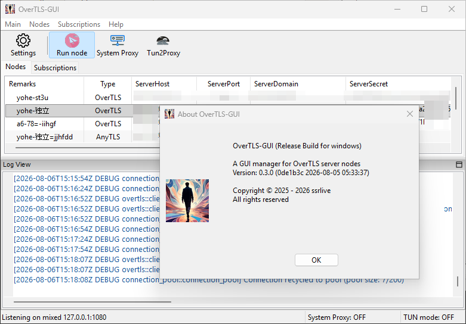
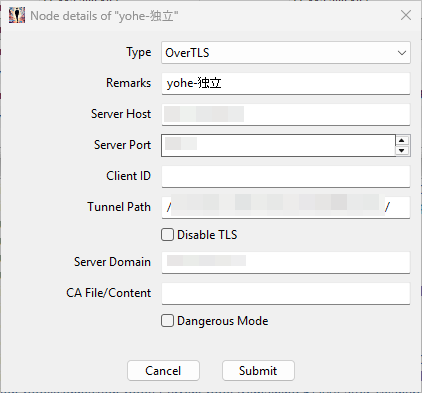
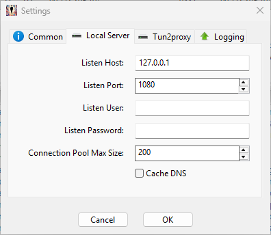

# OverTLS GUI

[English README](README.md)

OverTLS GUI 是一款使用 Rust 和 `wxDragon` 构建的桌面应用，为 [OverTLS](https://github.com/ShadowsocksR-Live/OverTLS) 和 [AnyTLS](https://github.com/ssrlive/anytls-rs) 代理节点提供图形化管理界面。
软件支持通过订阅管理节点、导入和导出二维码、日志查看以及系统托盘集成，可运行于 Linux、Windows 和 macOS。

## 功能亮点

- **节点管理**：添加、编辑、删除和查看 OverTLS 与 AnyTLS 服务器节点。
- **订阅支持**：管理订阅 URL、刷新订阅内容，并合并节点且避免重复。
- **自动刷新**：可通过“自动刷新”菜单项启用或关闭自动刷新，并设置刷新间隔。
- **二维码支持**：通过屏幕截图扫描二维码，也可显示节点二维码。
- **设置对话框**：配置 OverTLS、AnyTLS、Tun2proxy、日志和订阅刷新间隔。
- **系统托盘**：最小化到托盘、恢复窗口，并从托盘菜单访问设置。
- **权限处理**：检测管理员/root 权限，并在 Linux 上按需以提升后的权限重启。
- **日志**：集成日志捕获，并提供可配置的日志选项。

## 截图






## 安装与构建

### 环境要求

- Rust 1.85 或更高版本
- `cargo` 工具链
- `wxDragon` 所需的原生 GUI 依赖

### Linux 依赖

在 Debian/Ubuntu 上，安装构建 GUI 所需的常用原生软件包：

```bash
sudo apt-get update
sudo apt-get install --fix-missing -y libxmu-dev \
  libx11-dev libxext-dev libxft-dev libxinerama-dev libxcursor-dev libxrender-dev libxfixes-dev \
  libpango1.0-dev libgl1-mesa-dev libglu1-mesa-dev libgdk-pixbuf2.0-dev libgtk-3-dev libxdo-dev
```

### 构建

```bash
cargo build --release
```

### 运行

```bash
./target/release/overtls-gui
```

### 可选安装包

项目包含 `cargo-bundle` 配置，可用于在受支持的平台上打包。Linux 示例：

```bash
cargo install cargo-bundle
cargo bundle --release --format deb --target x86_64-unknown-linux-gnu
```

## 使用方法

- 添加并管理 OverTLS 和 AnyTLS 服务器节点。
- 从菜单或托盘打开“设置”，配置 OverTLS、AnyTLS、Tun2proxy、日志和订阅刷新。
- 使用“订阅”菜单添加、编辑、删除订阅 URL，或手动刷新订阅。
- 在“订阅”菜单中启用“自动刷新”，定期在后台刷新订阅。
- 在设置对话框中以分钟为单位配置刷新间隔。
- 使用“扫描二维码”从屏幕扫描二维码，并通过“显示二维码”查看节点二维码。
- 使用系统托盘图标隐藏或恢复窗口，也可快速访问设置。

## 配置

- 应用设置以 JSON 格式保存在用户配置目录中。
- 保存的数据包括窗口位置和大小、节点列表、订阅 URL、刷新间隔以及自动刷新状态。
- 订阅刷新结果会合并到节点列表并自动保存。

## 开发说明

- 使用 `wxDragon` 构建 GUI 前端。
- 使用 `reqwest` 获取订阅内容。
- 使用 `tun2proxy` 集成代理隧道。
- 使用 `serde`/`serde_json` 序列化配置。
- 订阅刷新在后台 worker 线程中执行，结果会派发回主 UI 线程。

## 许可证

- MIT

---

更多信息请参阅源代码和模块注释，或在仓库中提交 issue。
